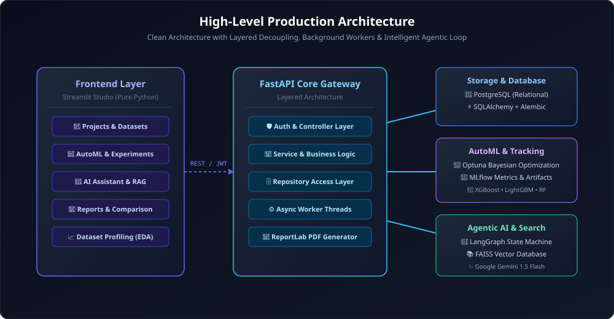
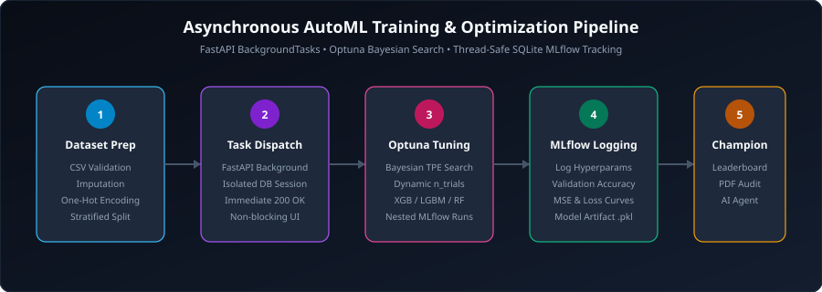
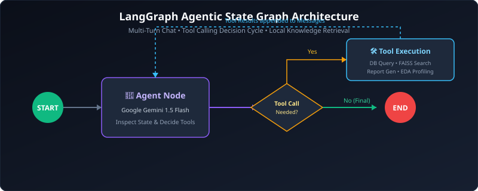

# 🏗️ System Architecture & Engineering Design

This document details the software design patterns, architectural choices, and technical trade-offs implemented throughout the **ML Experiment Orchestrator**.



---

## 🏛️ Layered Decoupled Architecture

The backend strictly adheres to Clean Architecture and the Repository Pattern across 5 distinct layers:

```text
[HTTP Requests] ➔ Controller / Endpoint Layer (app/api/v1/)
                        │
                        ▼
                Service Layer (app/services/)
                        │
                        ▼
                Repository Layer (app/repositories/)
                        │
                        ▼
                Database Layer (PostgreSQL + SQLAlchemy ORM)
```

### 1. Controller / Endpoints Layer (`app/api/v1/endpoints/`)
- Pure FastAPI routes handling HTTP request parsing, Pydantic validation, status codes, and HTTP exceptions.
- Dependency injection handles JWT bearer authentication (`get_current_user`) and database session lifecycle (`get_db`).

### 2. Service Layer (`app/services/`)
- Encapsulates business logic, access control authorization (ensuring users only access their own projects), metric aggregation, and background job dispatches.
- Interacts with ML engines (Optuna, Scikit-Learn, LightGBM, XGBoost) and reporting pipelines (ReportLab, Markdown).

### 3. Repository Layer (`app/repositories/`)
- Abstract data-access layer preventing raw database queries from leaking into business services.
- Clean CRUD interfaces for `Project`, `Dataset`, `Experiment`, and `Run` entities.

### 4. Database Layer (`app/database/`, `app/models/`)
- SQLAlchemy 2.0 ORM with PostgreSQL backend.
- Alembic schema migrations enabling transactional data definition changes.
- Connection pooling with scoped sessions.

---

## ⚡ Asynchronous AutoML & MLOps Engine



### Background Task Thread-Safety
When a model training job is triggered:
1. The API endpoint immediately returns HTTP 200 with run metadata.
2. Training executes asynchronously using FastAPI `BackgroundTasks`.
3. To avoid SQLAlchemy `InterfaceError` / `ProgrammingError` caused by connection pool recycling across worker threads, the background worker initializes an independent `SessionLocal()` session in a `try...finally` block.
4. Optuna coordinates Bayesian Tree-structured Parzen Estimator (TPE) search across model hyperparameter spaces.
5. Every trial is recorded as a nested run inside local MLflow tracking (`sqlite:///mlruns.db`).

---

## 🤖 Agentic AI & RAG State Machine



### LangGraph StateGraph Execution
The conversational AI Assistant operates as an autonomous agent with cyclical tool execution:
- **LLM Backbone:** Google Gemini 1.5 Flash (`ChatGoogleGenerativeAI`) with zero-temperature reasoning.
- **Agent Tools:** Direct bindings to query PostgreSQL projects, MLflow runs, compare models, and trigger automated research reports.
- **RAG Knowledge Base:** PyPDF parses documents into 1000-character chunks with 200-character overlap. Embedded via Google Generative AI embeddings into local FAISS vector store index.
