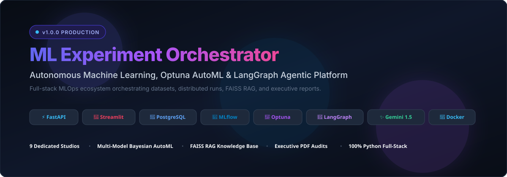
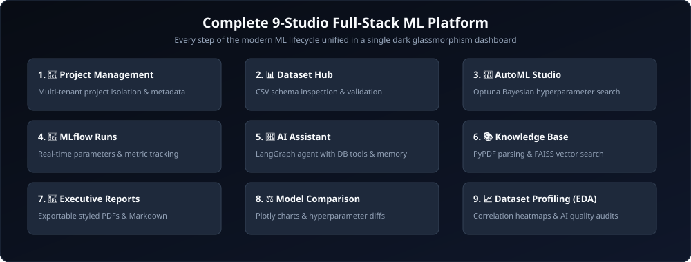
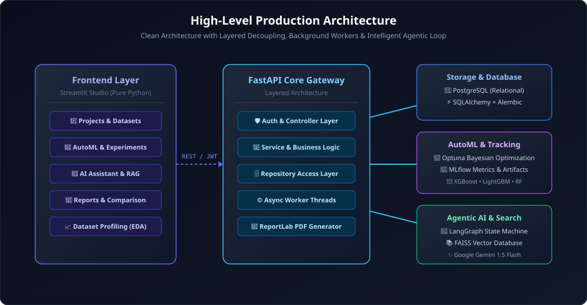
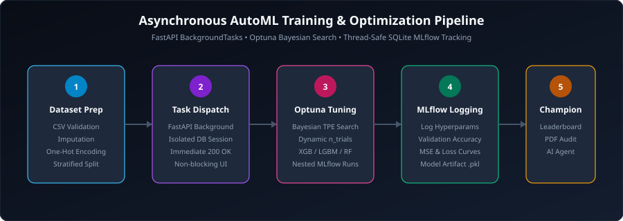
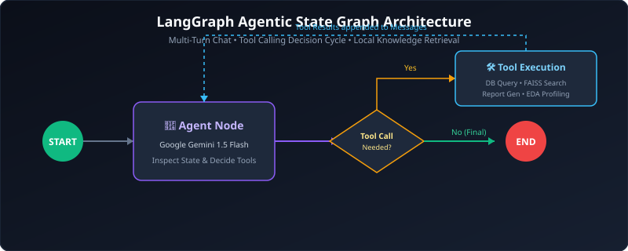

<p align="center">
  
</p>

<p align="center">
  <a href="https://www.python.org/"></a>
  <a href="https://fastapi.tiangolo.com/"></a>
  <a href="https://streamlit.io/"></a>
  <a href="https://www.postgresql.org/"></a>
  <a href="https://mlflow.org/"></a>
  <a href="https://optuna.org/"></a>
  <a href="https://langchain-ai.github.io/langgraph/"></a>
  <a href="https://www.docker.com/"></a>
</p>

> **A production-grade, full-stack Machine Learning & Agentic AI platform** integrating Bayesian AutoML, local MLflow tracking, LangGraph multi-turn research assistants, FAISS RAG, executive PDF reporting, model comparison, and automated dataset profiling.

---


---

## 🎨 The 9 Integrated Platform Studios

<p align="center">
  
</p>

| Studio | Icon | Capabilities & Technical Implementation |
|---|:---:|---|
| **1. Projects** | 📁 | Multi-tenant workspace isolation with creation metadata and cascade deletion. |
| **2. Datasets** | 📊 | Ingestion hub for CSV files with schema validation, storage metrics, and deletion controls. |
| **3. AutoML Studio** | 🧪 | Bayesian hyperparameter optimization across **XGBoost, LightGBM, and Random Forest**. Runs non-blocking via FastAPI background tasks. |
| **4. MLflow Runs** | 🏃 | Detailed experiment history tracking parameters, loss metrics, run duration, and artifact paths. |
| **5. AI Assistant** | 🤖 | Conversational AI Data Scientist built on **LangGraph + Google Gemini 1.5 Flash**, equipped with database query tools. |
| **6. Knowledge Base** | 📚 | Semantic search powered by **FAISS vector store** and PyPDF chunking for technical papers and runbooks. |
| **7. Executive Reports** | 📑 | Automated performance audits exportable as structured Markdown or **executive PDF reports via ReportLab**. |
| **8. Model Comparison** | ⚖️ | Interactive **Plotly** visualizer comparing trial accuracies with side-by-side parameter diffs. |
| **9. Dataset Profiling** | 📈 | Automated EDA: missing value analysis, **Pearson correlation heatmaps**, and AI quality audits. |

# 📖 Overview

AI Experiment Platform is a full-stack Machine Learning Experiment Orchestration system that enables users to manage datasets, automate ML experiments, track results, compare models, and leverage AI agents to assist throughout the ML lifecycle.

This project follows **production-grade software engineering practices**, including:

- Layered Architecture
- Repository Pattern
- Service Layer
- JWT Authentication
- Alembic Database Migrations
- Clean Code Principles
- Modular Project Structure

The long-term goal is to build an AI platform comparable to a combination of:

- MLflow
- Weights & Biases
- AutoML Platforms
- LangGraph Agent Systems
- AI Research Assistants

---

# 🏗️ Current Progress (Completed)

### Backend Foundation
- FastAPI Setup
- PostgreSQL Integration
- SQLAlchemy ORM
- Alembic Migrations
- Production Project Structure

### Authentication & Core Entities
- User Registration & JWT Login
- Project Management
- Dataset Upload & Storage

### MLOps & Machine Learning
- **ML Experiment Engine:** Core database structures for Experiments and Runs.
- **MLflow Tracking:** Local tracking server integration (SQLite `mlruns.db`).
- **AutoML Pipeline:** Asynchronous background tasks for non-blocking model training.
- **Hyperparameter Optimization:** Optuna objective functions dynamically tuning `RandomForest`, `XGBoost`, and `LightGBM`.

### Frontend Dashboard
- Pure Python **Streamlit** multi-page application.
- Authentication & JWT Session State handling.
- UIs for managing Projects, uploading Datasets, creating Experiments, and firing off AutoML runs.

---


# 📅 Future Enhancements

- Deep Learning Model Support (PyTorch/TensorFlow)
- Multi-Tenant Cloud Architecture
- Advanced Artifact Storage (S3 / GCS mapping)
- Webhooks & External Triggers

---

# 🛠 Tech Stack

## Backend
- Python 3.11
- FastAPI
- SQLAlchemy & Alembic
- PostgreSQL
- Pydantic
- Passlib (bcrypt) & Python-JOSE (JWT)

## Frontend
- Streamlit
- Pandas
- Requests

## Machine Learning & MLOps
- Scikit-Learn
- XGBoost
- LightGBM
- Optuna (Hyperparameter Tuning)
- MLflow (Experiment Tracking)

## CI/CD Pipeline
- GitHub Actions
- Pytest

## AI & Agents Stack
- Google Gemini (gemini-1.5-flash)
- LangChain & LangGraph
- FAISS Vector Database
- PyPDF Document Parsing
- Custom Agentic Tooling

---

# 📂 Current Project Structure

```text
ml-experiment-orchestrator/
│
├── backend/
│   ├── alembic/
│   ├── app/
│   │   ├── api/          # FastAPI Routes (v1)
│   │   ├── core/         # Config & Security
│   │   ├── database/     # DB Sessions & Base
│   │   ├── dependencies/ # Auth & DI
│   │   ├── agents/       # LangGraph Workflows & DB Tools
│   │   ├── ml/           # AutoML Pipeline, Optuna Tuner, Data Loader
│   │   ├── models/       # SQLAlchemy Models
│   │   ├── rag/          # Semantic Search, FAISS, PyPDF
│   │   ├── comparison/   # Multi-Run Analytics & Leaderboard
│   │   ├── profiling/    # Automated EDA & Summary Profiler
│   │   ├── reporting/    # PDF & Markdown Report Generators
│   │   ├── repositories/ # Data Access Layer
│   │   ├── schemas/      # Pydantic Validation
│   │   ├── services/     # Business Logic
│   │   └── main.py       # Entrypoint
│   ├── requirements/
│   └── .env
│
└── frontend/
    ├── app.py            # Streamlit Entrypoint & Auth UI
    ├── pages/            # Projects, Datasets, Experiments, Runs, AI Assistant, Knowledge Base, Reports, Model Comparison, Dataset Profiling
    └── utils/            # API wrappers and Session management
```

---

# 🔐 Authentication Flow

```text
Register ➔ Hash Password (bcrypt) ➔ Store User
Login ➔ Verify Password ➔ Generate JWT ➔ Protected Routes ➔ Current User
```

---


---

## 🏛️ System Architecture

<p align="center">
  
</p>

The platform follows a strict **Clean Layered Architecture** with decoupled layers:
- **API Gateway (FastAPI)**: Controller endpoints validating inputs with Pydantic and managing auth via JWT.
- **Service & Business Layer**: Dispatches asynchronous training jobs and coordinates analytics.
- **Data Access Layer**: Clean repository pattern preventing ORM leaks into business logic.
- **Database & Storage**: PostgreSQL handles relational entities while SQLite manages local MLflow experiment metrics.
- **AI Agent Brain**: LangGraph StateGraph cyclic agent equipped with dynamic tools for relational queries and FAISS vector retrieval.

---

## ⚡ Asynchronous AutoML & Optuna Pipeline

<p align="center">
  
</p>

---

## 🤖 Agentic AI & StateGraph Workflow

<p align="center">
  
</p>

# 🧠 Software Architecture

```text
Client ➔ API Layer ➔ Service Layer ➔ Repository Layer ➔ Database
```

Each layer has a single responsibility:
- **API Layer** → Handles HTTP requests/responses, triggers background tasks
- **Service Layer** → Business logic & ML Orchestration
- **Repository Layer** → Database operations
- **Database Layer** → PostgreSQL persistence

---


---

## ⚡ 60-Second Instant Preview & Seeding

Explore the platform immediately with pre-populated benchmark datasets and experiments:

```bash
# 1. Seed demo user, benchmark project, and datasets
python scripts/run_demo.py

# 2. Launch the services
# Option A: With Docker
docker-compose up --build

# Option B: Locally
cd backend && uvicorn app.main:app --reload &
cd frontend && streamlit run app.py
```

**Default Demo Credentials:**
- **Email:** `demo@orchestrator.ai`
- **Password:** `demo1234`

# 🔑 Implemented REST APIs

| Method | Endpoint | Status |
|---------|----------|--------|
| POST | `/api/v1/auth/register` | ✅ |
| POST | `/api/v1/auth/login` | ✅ |
| GET | `/api/v1/auth/me` | ✅ |
| CRUD | `/api/v1/projects/*` | ✅ |
| CRUD | `/api/v1/projects/{id}/datasets/*` | ✅ |
| CRUD | `/api/v1/projects/{id}/experiments/*` | ✅ |
| POST | `/api/v1/experiments/{id}/runs` | ✅ |
| POST | `/api/v1/experiments/{id}/train` | ✅ (AutoML) |
| GET | `/api/v1/reports/{project_id}/summary` | ✅ (Markdown Report) |
| GET | `/api/v1/reports/{project_id}/pdf` | ✅ (Executive PDF) |
| GET | `/api/v1/comparison/{project_id}` | ✅ (Model Leaderboard) |
| GET | `/api/v1/projects/{project_id}/datasets/{dataset_id}/profile` | ✅ (EDA Profile) |

---

# 📚 Learning Objectives

This project demonstrates:
- Backend Engineering & API Development
- Machine Learning Engineering & MLOps
- AI Engineering & Agentic Workflows
- Database Design & ORMs
- Clean Architecture & Repository Pattern
- Production Software Design

---

# 📈 Roadmap

- [x] FastAPI Setup
- [x] PostgreSQL Integration
- [x] SQLAlchemy ORM
- [x] Alembic Migrations
- [x] User Authentication
- [x] JWT Authorization
- [x] Project Management
- [x] Dataset Upload
- [x] Streamlit Dashboard
- [x] ML Experiment Engine
- [x] MLflow Tracking
- [x] Hyperparameter Optimization
- [x] AI Agents
- [x] LangGraph Workflows
- [x] RAG Search
- [x] Docker
- [x] CI/CD
- [x] Deployment
- [x] Automated AI Report Generation (PDF & Markdown)
- [x] Model Comparison & Interactive Leaderboards (Plotly)
- [x] Automated Dataset Profiling & EDA Studio

---

# 🚀 Project Status

**Current Version:** `v1.0.0`

**Completion:** **100%**

The Backend Foundation, Authentication, Project Management, Dataset Uploads, **Machine Learning Engine**, **Hyperparameter Optimization**, **MLflow tracking**, and **Streamlit Dashboard** are fully integrated and complete. 

The ML Engine, AutoML, Streamlit UI, LangGraph AI Agents, RAG Search, Docker Containerization, CI/CD, and Deployment are 100% complete and deployed.

---


---

## 🏆 Key Technical Accomplishments & Production Decisions

- **Full-Stack Python Synergy:** Eliminates context switching by unifying high-performance asynchronous API controllers (FastAPI) with rich interactive dashboards (Streamlit).
- **Thread-Safe Asynchronous MLOps:** Resolved database connection pool conflicts in long-running background tasks by implementing isolated thread sessions for Optuna objective evaluation.
- **Enterprise Reporting Engine:** Integrated pure-Python ReportLab canvas rendering for pixel-perfect executive PDF summaries with color-coded benchmark tables.
- **Production Containerization:** Multi-service `docker-compose.yml` orchestrating PostgreSQL, FastAPI, and Streamlit with healthchecks, environment security, and persistent volumes.
- **Detailed Documentation:** Complete references in [ARCHITECTURE.md](ARCHITECTURE.md), [API_DOCS.md](API_DOCS.md), [SHOWCASE.md](SHOWCASE.md), and [DEPLOYMENT.md](DEPLOYMENT.md).

# 👨‍💻 Author

**Yashashvi Srivastava**

AI/ML Engineer | Backend Developer | Agentic AI Enthusiast

Building production-ready AI applications using Machine Learning, LLMs, Agentic AI, and MLOps best practices.

---

⭐ If you find this project interesting, consider giving it a star!
