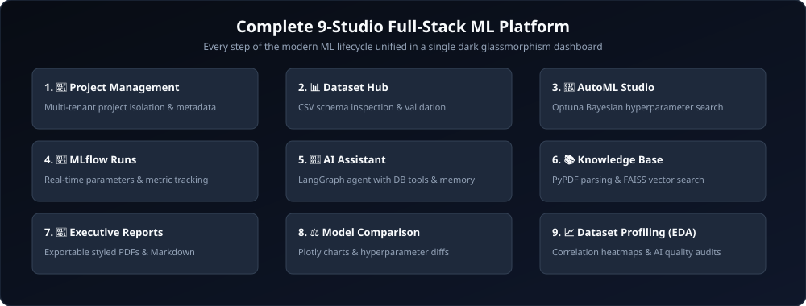

# 🌟 Portfolio Showcase & Technical Highlights

> **ML Experiment Orchestrator** is an end-to-end, production-grade MLOps & Agentic AI platform built entirely in Python.

---

## 🎯 Engineering Highlights & Key Challenges Solved

### 1. Full-Stack Python Architecture
- **Challenge:** Creating an intuitive, modern, responsive multi-page dashboard without introducing a complex Node.js/React frontend toolchain.
- **Solution:** Leveraged **Streamlit** styled with custom dark glassmorphism CSS tokens (`frontend/utils/styles.py`), wide-aspect KPI metric cards, and responsive Plotly visualizers.

### 2. Multi-Framework Bayesian AutoML
- **Challenge:** Coordinating non-blocking model training across multiple machine learning frameworks without hanging the web server.
- **Solution:** Implemented Optuna objective functions supporting `XGBoost`, `LightGBM`, and `RandomForest` executed in non-blocking FastAPI `BackgroundTasks` with thread-isolated SQLAlchemy sessions.

### 3. Agentic Workflow with LangGraph & Tool Calling
- **Challenge:** Providing conversational access to complex relational schemas, MLflow metrics, and unstructured research PDFs.
- **Solution:** Constructed a LangGraph StateGraph powered by Google Gemini 1.5 Flash. The agent autonomously determines when to query database state, vectorize queries against FAISS, or compile performance summaries.

### 4. Executive PDF & Markdown Generation
- **Challenge:** Enabling researchers and business stakeholders to export professional, executive-ready documentation of experiment findings.
- **Solution:** Built automated ReportLab PDF canvas generators styling tabular champion benchmarks, hyperparameter tables, and AI-synthesized narrative recommendations.

---

## 💡 Quick Statistics
- **Total Git Commits:** 240+ granular commits
- **Architecture Layers:** 5 (Controller, Service, Repository, Database, Agent)
- **Supported ML Frameworks:** XGBoost, LightGBM, Scikit-Learn, Optuna, MLflow
- **Vector Search:** FAISS with Google Generative AI embeddings
- **Containerization:** Docker & Docker Compose with multi-stage builds
